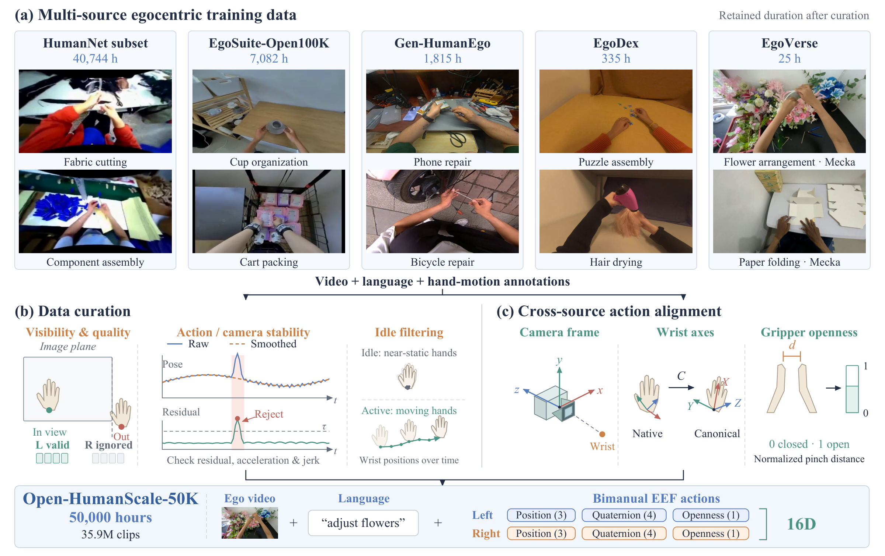
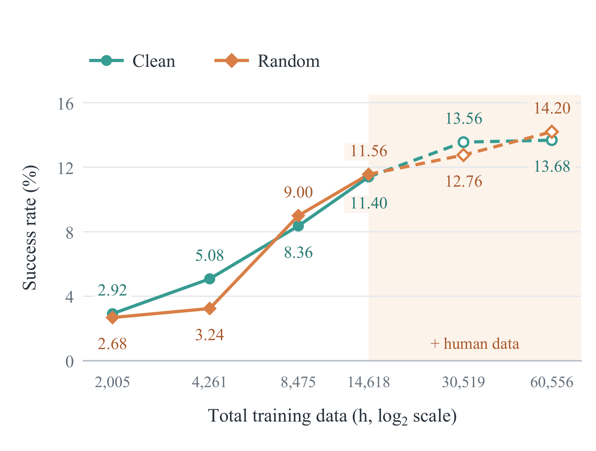

<div align="center">

<p></p>

### An Open Recipe for Scaling Human and Robot Experience<br>for Embodied Foundation Models

[](#citation)
[](https://jiankai-ss.github.io/open-humanscale/)
[](https://huggingface.co/datasets/DAGroup-PKU/Open-HumanScale-50k)
[](https://huggingface.co/collections/DAGroup-PKU/open-humanscale)
[](https://modelscope.cn/datasets/DAGroup-PKU/EgoCorpus-50kH-LeRobot-v3)

</div>


**Open-HumanScale** shows how scaling human experience improves robot
**generalization, zero-shot execution, and post-training performance**.
Scaling egocentric pretraining from **100 to 50,000 hours** raises Scene-OOD
success from **49.1% to 73.2%**. Adding human data to a fixed robot corpus
improves zero-shot success from **11.48% to 13.94% on RoboTwin** and from
**20.0% to 30.5% across 20 real-world tasks**.

> 🏆 **RoboTwin 2.0 Benchmark — Rank #1.** With refined post-training,
> **HumanWAM-Goal** achieves **88.65% average success**, with **92.70% Clean / 84.60% Random**.
> Co-train track, without observed depth; comparison reported in our technical report.

[](https://jiankai-ss.github.io/open-humanscale/assets/videos/presentation/Open-HumanScale_v4.mp4)

<p align="center"><a href="https://jiankai-ss.github.io/open-humanscale/assets/videos/presentation/Open-HumanScale_v4.mp4">▶ Watch the full demo</a> · <a href="https://jiankai-ss.github.io/open-humanscale/">More demos on the project page</a></p>

## 🔥 News

- **[2026/11/05]** We release the **Open-HumanScale technical report**!
  [Model weights](https://huggingface.co/collections/DAGroup-PKU/open-humanscale)
  and the [Open-HumanScale-50k corpus](https://huggingface.co/datasets/DAGroup-PKU/Open-HumanScale-50k)
  are being uploaded. We are actively organizing the code and documentation.

## Table of Contents

- [Open-HumanScale-50k Corpus](#open-humanscale-50k-corpus)
- [HumanWAM-Vanilla](#humanwam-vanilla)
  - [Weight Download](#vanilla-weight-download)
  - [Environment Setup & Quick Start](#vanilla-quick-start)
  - [Training](#vanilla-training)
  - [Inference](#vanilla-inference)
  - [Reproduction Guide](#vanilla-reproduction-guide)
- [HumanWAM-Goal](#humanwam-goal)
  - [Weight Download](#goal-weight-download)
  - [Environment Setup & Quick Start](#goal-quick-start)
  - [Inference](#goal-inference)
- [Release Plan](#release-plan)
- [License](#license)
- [Citation](#citation)
- [Acknowledgements](#acknowledgements)

## Open-HumanScale-50k Corpus

**Open-HumanScale-50k: 50,000 hours · 35.9M clips · Video, hand motion, and language.**

Curated from HumanNet, EgoSuite-Open100K, EgoDex, Gen-HumanEgo, and EgoVerse,
with hand-visibility, motion-stability, and activity filtering, followed by
cross-source alignment to a unified bimanual action representation.



*Construction of Open-HumanScale-50k. (a) Five data sources and their retained
hours. (b) Curation by hand visibility, motion stability, and manipulation
activity. (c) Alignment of camera frames, wrist axes, and gripper openness.*

- **Corpus:** [Hugging Face](https://huggingface.co/datasets/DAGroup-PKU/Open-HumanScale-50k).
- **Mirror:** [ModelScope](https://modelscope.cn/datasets/DAGroup-PKU/EgoCorpus-50kH-LeRobot-v3) — not uploaded yet.
- **Format:** LeRobot v3, with compressed MP4 video and language annotations.

The Hugging Face upload is in progress. Download instructions are being prepared.

## HumanWAM-Vanilla

<a id="vanilla-weight-download"></a>
### Weight Download

Pretrained, RoboTwin post-trained, scaling, and ablation checkpoints are being
uploaded to **one model repository**, organized under separate paths and linked
from the [Open-HumanScale Collection](https://huggingface.co/collections/DAGroup-PKU/open-humanscale).

| Checkpoint | Clean2Clean | Clean2Random | Average | Status |
| --- | ---: | ---: | ---: | --- |
| HumanWAM-Vanilla · RoboTwin post-trained | **92.08%** | **68.88%** | **80.48%** | [Uploading](https://huggingface.co/collections/DAGroup-PKU/open-humanscale) |
| HumanWAM-Vanilla · egocentric pretrained | — | — | — | [Uploading](https://huggingface.co/collections/DAGroup-PKU/open-humanscale) |

Results are reported in the technical report; both RoboTwin settings use the
same post-trained checkpoint. Direct download paths are being prepared.

Scaling human pretraining from 100 to 50,000 hours improves Scene-OOD success
from **49.1% to 73.2%** in the controlled IDM study:


<a id="vanilla-quick-start"></a>
### Environment Setup & Quick Start

🚧 Work in progress.

<a id="vanilla-training"></a>
### Training

🚧 Work in progress.

<a id="vanilla-inference"></a>
### Inference

🚧 Work in progress.

<a id="vanilla-reproduction-guide"></a>
### Reproduction Guide

🚧 Work in progress.

## HumanWAM-Goal

<a id="goal-weight-download"></a>
### Weight Download

Hybrid pretrained / zero-shot checkpoints and RoboTwin post-trained weights are
being uploaded under Goal-specific paths in the same model repository, linked
from the [Open-HumanScale Collection](https://huggingface.co/collections/DAGroup-PKU/open-humanscale).

| Checkpoint | Clean2Clean | Clean2Random | Average | Status |
| --- | ---: | ---: | ---: | --- |
| HumanWAM-Goal · RoboTwin post-trained | **92.70%** | **84.60%** | **88.65%** | [Uploading](https://huggingface.co/collections/DAGroup-PKU/open-humanscale) |

Results are reported in the technical report under the official 10,000-episode
protocol. Direct download paths are being prepared.

Without target-task parameter updates, HumanWAM-Goal achieves **13.94% mean
zero-shot success on RoboTwin** and **30.5% across 20 real-world tasks**.

<p align="center">
  
  
</p>

<a id="goal-quick-start"></a>
### Environment Setup & Quick Start

🚧 Work in progress.

<a id="goal-inference"></a>
### Inference

🚧 Work in progress.

## Release Plan

- [ ] Open-HumanScale-50k corpus — uploading to Hugging Face; ModelScope pending.
- [ ] Pretrained and RoboTwin post-trained weights — uploading.
- [ ] HumanWAM-Vanilla code, training, inference, and reproduction guide — in progress.
- [ ] HumanWAM-Goal code, environment setup, and inference — in progress.

## License

Open-HumanScale is released under the [Apache License 2.0](Apache-2.0.txt).
Existing component notices and license terms remain applicable. Corpus and
checkpoint terms will be specified in their release cards.

## Citation

If you find Open-HumanScale useful, please cite our technical report.
The entry below follows the current manuscript; the arXiv identifier will be
added when available.

```bibtex
@unpublished{ma2026openhumanscale,
  title = {Open-HumanScale: An Open Recipe for Scaling Human and Robot Experience for Embodied Foundation Models},
  author = {Juncheng Ma and Jiaxin Li and Jiankai Tu and Bo Liang and
    Guodong Lv and Yufan Deng and Junzhe Tang and Liangzhu Yang and
    Chen Bian and Zicong Cao and Baohao Zhu and Jianxin Bi and
    Tengfei Yan and Yinyuan Zhang and Kewei Zhang and Xinglong Chen and
    Kaiqi Chen and Duomin Wang and Xiaotian Tang and Liang Tan and
    Li Li and Yuan Xu and Haosen Yang and Yuqi Wang and
    Jingfei Xia and Songyan Huang and Zhiyang Dou and Zhen Dong and
    Enze Xie and Tat-Seng Chua and Daquan Zhou},
  year = {2026},
  note = {Technical report},
  url = {https://jiankai-ss.github.io/open-humanscale/}
}
```

## Acknowledgements

We thank [FastWAM](https://github.com/yuantianyuan01/FastWAM) and
[ViGAR](https://github.com/DAGroup-PKU/ViGAR) for their open-source contributions.
