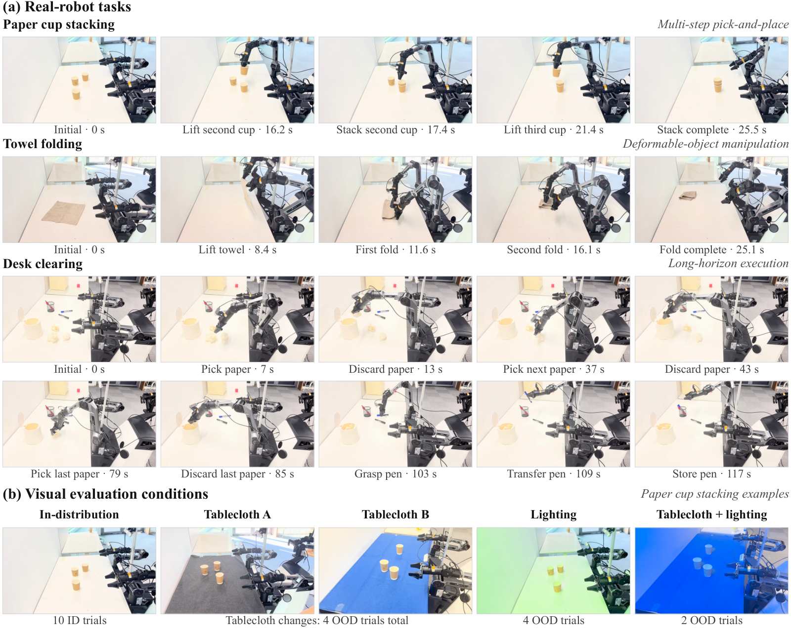

<div align="center">

# Open-HumanScale

### Scaling Human Experience for Robot Learning

**HumanWAM · RoboTwin Post-training**

[](#-news)
[](docs/code_guide.md)
[](ROADMAP.md)

[**Demos**](#-demos) · [**Results**](#-key-results) · [**Getting Started**](#-getting-started) · [**Release Plan**](ROADMAP.md) · [**Experiments**](docs/experiments.md)

</div>

**Open-HumanScale** studies how human egocentric experience improves robot learning
as data scale, diversity, and action supervision change. **HumanWAM** connects
future video prediction with action generation, then adapts to robot manipulation
through post-training on robot demonstrations.

This repository hosts the **RoboTwin post-training code and experiment release**.
Pretraining code and initialization weights are outside its release scope.

## 🔥 News

- **[2026/11/02]** The first public code preview is available: HumanWAM model and
  trainer, RoboTwin data loading, configuration references, and CPU checks.
- **[Next]** Release the main RoboTwin policy bundle and evaluation interface.
  Follow the [release plan](ROADMAP.md) for progress and deliverables.

## 💡 Highlights

- **Human experience transfers to robots.** HumanWAM reaches **92.08% Clean2Clean**
  and **68.88% Clean2Random** success on RoboTwin after clean-only post-training.
- **Generalization beyond simulation.** Across three real-robot tasks, mean
  out-of-distribution success improves from **3.3% to 66.7%** over No-Ego.
- **A systematic study of adaptation.** The release plan covers data scaling,
  diversity, alignment, action supervision, multi-view adaptation, demonstration
  efficiency, robot-versus-human initialization, and model ablations.

## 🦾 Demos



*Real-robot rollout keyframes from the paper: cup stacking, towel folding, and
long-horizon desk clearing, with changes in tablecloth and lighting. These are
selected frames, not playable videos. This code release focuses on RoboTwin.*

## 📊 Key Results

### RoboTwin 2.0

| Model | Clean2Clean | Clean2Random | Average |
| --- | ---: | ---: | ---: |
| **HumanWAM** | **92.08%** | **68.88%** | **80.48%** |

50 clean training demonstrations per task; 50 tasks × 50 evaluation episodes per
setting. Both settings use the same **50kh-initialized** policy and unseen
instructions. [Checkpoint and evaluation details →](docs/paper_alignment.md)

### Real robots

| Model | In-distribution | Out-of-distribution |
| --- | ---: | ---: |
| No-Ego | 56.7% | 3.3% |
| **HumanWAM** | **86.7%** | **66.7%** |

Mean success across cup stacking, towel folding, and desk clearing; 10 trials per
task, model, and setting. All results above are reported in the paper.

## 🗓️ Release Plan

- [x] Initial HumanWAM/RoboTwin source and configuration preview.
- [x] Key results, demo keyframes, and experiment index.
- [ ] **Next:** main policy weights, matching configuration and normalization statistics.
- [ ] RoboTwin inference adapter, evaluation commands, and rollout videos.
- [ ] Data preparation tools and a verified post-training walkthrough.
- [ ] Complete experiment configurations, checkpoints, and result mappings.

Weights will be organized under **one OpenHumanScale Collection in `DAGroup-PKU`**,
with **one model repository per experiment group**. Download links will appear
here when the bundles are available.

See [ROADMAP.md](ROADMAP.md) for milestone details and
[CHANGELOG.md](CHANGELOG.md) for completed updates. This is currently a code
preview; the full checkpoint-to-evaluation workflow is being prepared.

## 🚀 Getting Started

Clone the repository and inspect the source release with Python 3.10+:

```bash
git clone https://github.com/ucasmjc/OpenHumanScale.git
cd OpenHumanScale
python3 scripts/check_release.py
```

This source check needs no GPU or model download. Continue with the
[code guide](docs/code_guide.md) for installation, local data paths, and the
fine-tuning entry point. Public checkpoint downloads and simulator evaluation
are tracked in the [next milestone](ROADMAP.md#m1--main-policy-and-evaluation-in-progress).

| Resource | Contents |
| --- | --- |
| [Code guide](docs/code_guide.md) | Installation and RoboTwin post-training setup |
| [Experiment index](docs/experiments.md) | Experiment groups and planned weight repositories |
| [Result details](docs/paper_alignment.md) | Reported policy, evaluation protocol, and provenance |
| [Release plan](ROADMAP.md) | Upcoming deliverables and completion criteria |

## 🤝 Feedback

Please use [GitHub Issues](https://github.com/ucasmjc/OpenHumanScale/issues) for
bugs and reproduction questions. Include your environment, configuration, and
relevant error output when reporting a problem.

## 📄 Paper and Citation

The public paper link and BibTeX entry will be added when available. Results and
terminology currently follow the November 2, 2026 manuscript.

## License and Acknowledgments

We build on FastWAM, Wan, and LeRobot. The inherited source license is
[MIT](LICENSE); vendored components retain their own licenses and notices.
See [third-party acknowledgments](THIRD_PARTY_NOTICES.md).
