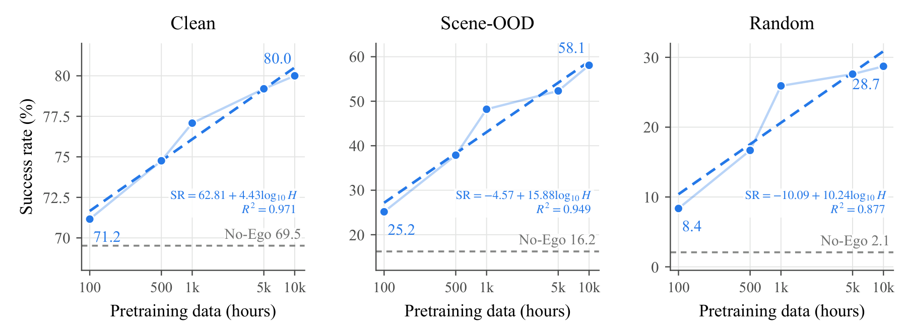
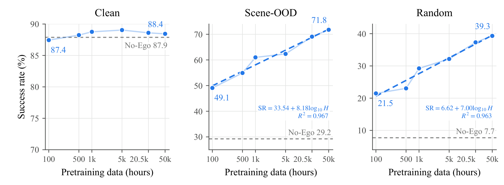
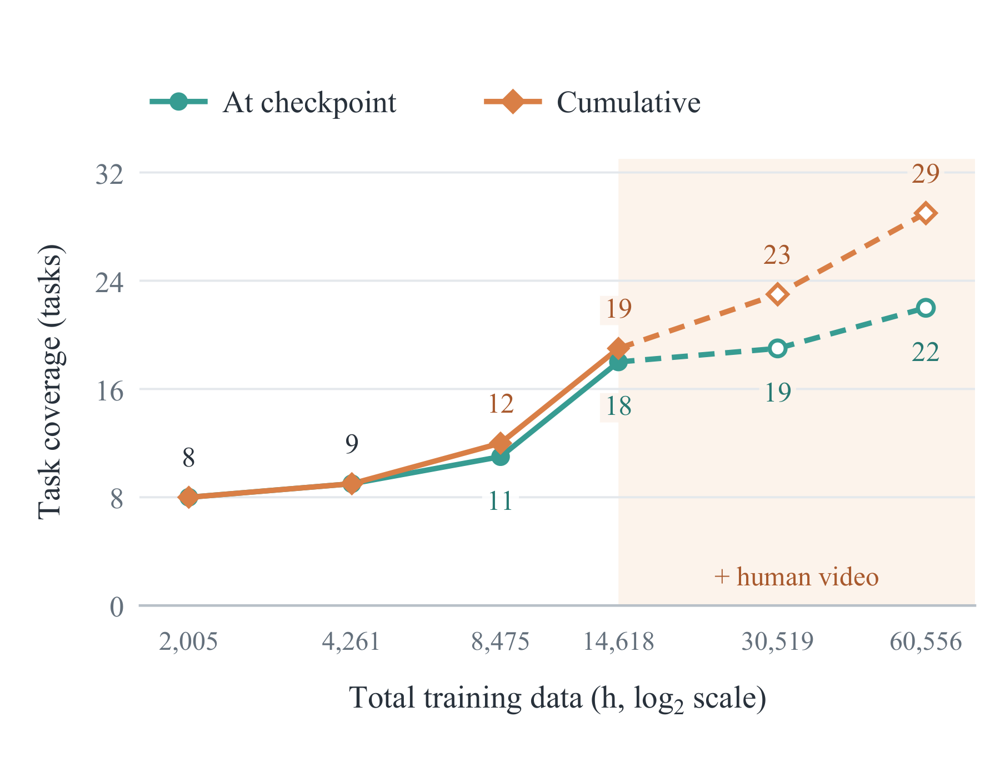
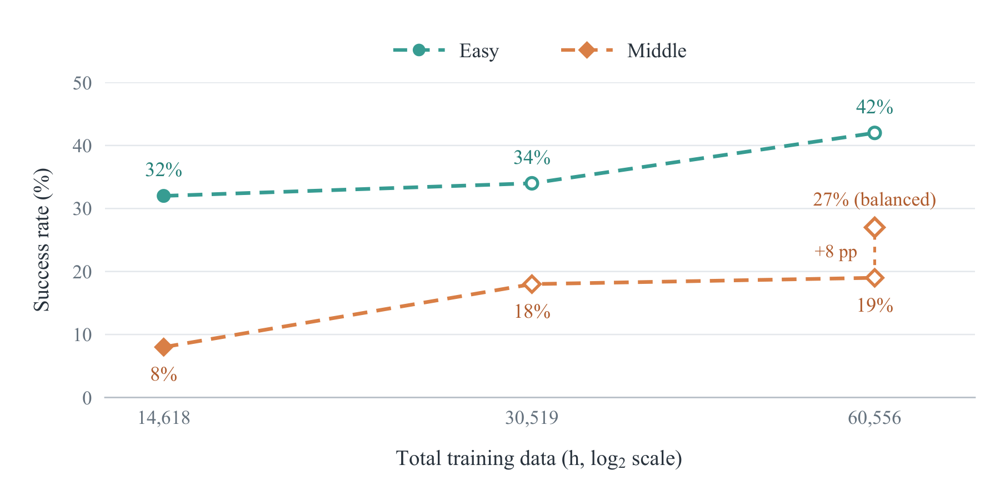
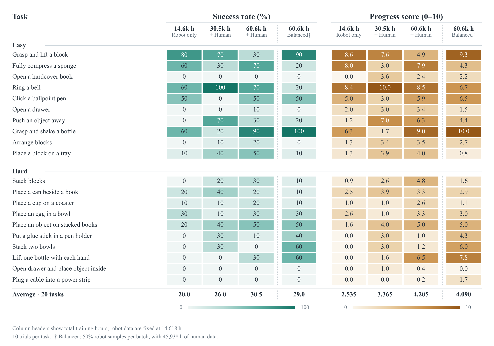

<div align="center">

# Open-HumanScale

### The Emerging Capability on Embodied Foundation Model<br>from Large Scale Hybrid Data Scaling

**Human Data Scaling · Zero-Shot Robot Learning**

[](#-paper-and-citation)
[](docs/resources.md#project-page)
[](docs/resources.md#datasets)
[](docs/resources.md#models)
[](docs/resources.md#datasets)

[**Scaling**](#-scaling-human-experience) · [**Zero-Shot**](#-zero-shot-robot-learning) · [**Getting Started**](#-getting-started) · [**Release Plan**](ROADMAP.md) · [**Experiments**](docs/experiments.md)

</div>

**Open-HumanScale** studies how human egocentric experience improves robot learning
as data scale, diversity, and action supervision change. **HumanWAM-Vanilla** connects
future video prediction with action generation, then adapts to robot manipulation
through post-training on robot demonstrations. **HumanWAM-Goal** explores
zero-shot execution through hybrid human–robot training and visual goals.

This repository hosts the **RoboTwin post-training code and experiment release**.
Pretraining code and initialization weights are outside its release scope.

## 🔥 News

- **[2026/11/03]** Updated scaling figures and results from the latest manuscript.
  The 50k-hour LeRobot v3 dataset conversion is complete; dataset uploads are in progress.
- **[2026/11/02]** The first public code preview is available: HumanWAM model and
  trainer, RoboTwin data loading, configuration references, and CPU checks.
- **[Next]** Release the main RoboTwin policy bundle and evaluation interface.
  Follow the [release plan](ROADMAP.md) for progress and deliverables.

## 📈 Scaling Human Experience

**More human experience improves downstream generalization.** Scaling egocentric
pretraining from **100 to 50,000 hours** raises Scene-OOD success from **49.1% to
73.2%** and Random success from **21.5% to 42.9%** with inverse-dynamics attention.

**Isolated attention · 100–10,000 hours**



**Inverse-dynamics attention · 100–50,000 hours**



*After RoboTwin post-training. The scaling study reports the best success
rate per evaluation setting; dashed blue curves are empirical log-linear fits,
and gray lines are No-Ego baselines.*

## 🎯 Zero-Shot Robot Learning

HumanWAM-Goal executes tasks **without target-task parameter updates**.

### RoboTwin: success and task coverage

With robot data fixed at **14,618 hours**, adding **45,938 hours** of human data
raises average zero-shot success from **11.48% to 13.94%** and per-checkpoint
task coverage from **18 to 22 of 50 tasks**.

<p align="center">
  
  
</p>

*50 Clean and 50 Random episodes per executed task; all 50 tasks remain in the
scoring denominator. Coverage requires ≥2% mean success across the two settings.
“Cumulative” is the union across independently trained configurations.*

### Real robots: scaling and per-task results

Across **20 tasks**, average zero-shot success increases from **20.0% → 26.0% →
30.5%** as human data scale from **0 → 15,901 → 45,938 hours**, with robot data fixed.





*10 trials per task. The 30.5% result uses the scaling-series configuration.
“Balanced” is a separate 50:50 robot/human sampling variant at the same data scale;
it raises success on the Hard task group from 19% to 27%, with 29% success overall.*

These figures report paper results. Real-robot demos will be hosted on the project
page; its link will be added when public. For the released HumanWAM code's
post-training benchmark and checkpoint mapping, see [result details](docs/paper_alignment.md).

## 🗓️ Release Plan

- [x] Initial HumanWAM/RoboTwin source and configuration preview.
- [x] Scaling and zero-shot result figures, and experiment index.
- [ ] **Next:** main policy weights, matching configuration and normalization statistics.
- [ ] RoboTwin inference adapter and evaluation commands.
- [ ] Data preparation tools and a verified post-training walkthrough.
- [ ] Complete experiment configurations, checkpoints, and result mappings.

Weights will be organized under **one OpenHumanScale Collection in `DAGroup-PKU`**,
with **one model repository per experiment group**. Download links will appear
here when the bundles are available.

See [ROADMAP.md](ROADMAP.md) for milestone details and
[CHANGELOG.md](CHANGELOG.md) for completed updates. This is currently a code
preview; the full checkpoint-to-evaluation workflow is being prepared.

## 🚀 Getting Started

Clone the repository and inspect the source release with Python 3.10+:

```bash
git clone https://github.com/ucasmjc/OpenHumanScale.git
cd OpenHumanScale
python3 scripts/check_release.py
```

This source check needs no GPU or model download. Continue with the
[code guide](docs/code_guide.md) for installation, local data paths, and the
fine-tuning entry point. Public checkpoint downloads and simulator evaluation
are tracked in the [next milestone](ROADMAP.md#m1--main-policy-and-evaluation-in-progress).

| Resource | Contents |
| --- | --- |
| [Paper, project page, datasets, and models](docs/resources.md) | Publication links and availability |
| [Code guide](docs/code_guide.md) | Installation and RoboTwin post-training setup |
| [Experiment index](docs/experiments.md) | Experiment groups and planned weight repositories |
| [Result details](docs/paper_alignment.md) | Reported policy, evaluation protocol, and provenance |
| [Release plan](ROADMAP.md) | Upcoming deliverables and completion criteria |

## 🤝 Feedback

Please use [GitHub Issues](https://github.com/ucasmjc/OpenHumanScale/issues) for
bugs and reproduction questions. Include your environment, configuration, and
relevant error output when reporting a problem.

## 📄 Paper and Citation

arXiv and the project page are coming soon. The paper link and BibTeX entry will
be added when available. Results and terminology follow the November 3, 2026
manuscript; dataset and model availability is tracked in [Resources](docs/resources.md).

## License and Acknowledgments

We build on FastWAM, Wan, and LeRobot. The inherited source license is
[MIT](LICENSE); vendored components retain their own licenses and notices.
See [third-party acknowledgments](THIRD_PARTY_NOTICES.md).
